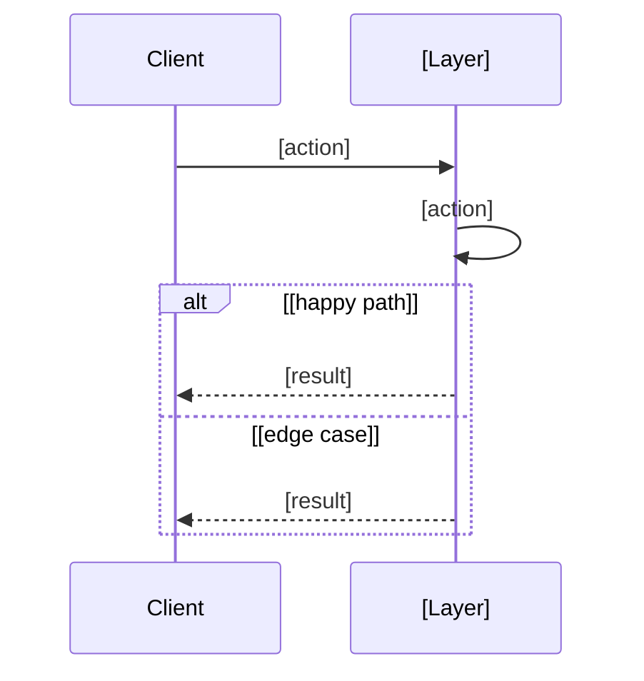

<!--
  docs/architecture.md template, for app repos (deployed services), derived
  from slug-pages and product-catalog. Not used by library repos, which have
  no docs/ folder.

  Two sections, in this order. Both carry a Mermaid diagram plus prose that
  explains the *why*, not just the *what*: the diagram shows the shape, the
  text carries the non-obvious rule (an invariant, a race condition, a
  guarantee).
-->

# Architecture

## Domain Model

[Prose: name the aggregate root(s)/entities, and state the invariants that
hold for them (uniqueness rules, valid ranges, what a soft-delete flag
means, what a state machine allows). This is the part a diagram can't
express on its own.]

```mermaid
classDiagram
    class [Entity] {
        +[Type] [Field]
        +[Type] [Field]
        +[Method](args)
    }
```

## [Request Flow | Save Flow | <domain-specific name>]

[Prose: one representative example. Pick the flow that's either the most
common or the one with a non-obvious rule (a concurrency check, a retry, an
ordering guarantee), and say why it's representative if that's not
obvious.]



[Optional trailing paragraph: one edge case or bypass worth calling out
explicitly, e.g. what a "force" flag does, what happens on conflict.]
